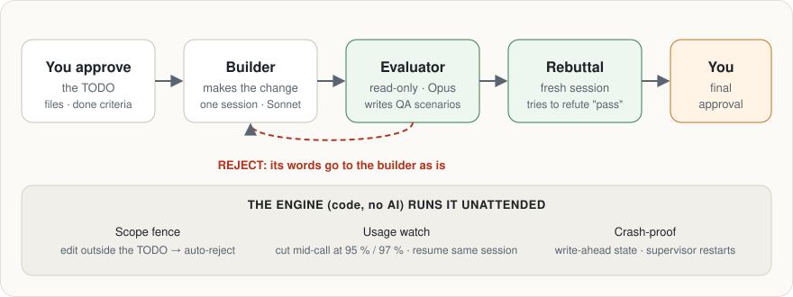

<div align="center">

# AgentWorkflow

### Claude Code를 몇 시간씩 맡겨 두는 엔진.<br>만든 AI가 자기 작업을 채점하지 않는다.

[](LICENSE)
[](https://github.com/sasostudio/agentworkflow/releases)


길고 무인으로 도는 Claude Code 작업을 코드가 지휘한다. **작업자**가 만들고, 별도의 읽기 전용 **평가자**가 판정하고,<br>새 세션이 그 통과를 반박해 보고, 마지막 승인은 **사람**이 한다. 사람의 결정이 필요할 때마다 깔끔하게 멈춘다.

[설치](#설치) · [실전 기록](#실전-기록) · [누구에게 맞나](#누구에게-맞나) · [`/goal`과 차이](#goal과-차이) · [English](README.md)



</div>

> **비공식 도구다.** Anthropic과 관계없고 Anthropic이 보증하지 않는다. 내 PC에서 공식 `claude` CLI를 수정 없이 실행하며, 로그인은 **내** Claude 계정 또는 **내** API 키로 한다.
> **Windows 전용**(Windows 11 · PowerShell에서 실측). **프롬프트·규칙 파일은 한국어**다.

```
PLANNING(코드) ─ Master가 쓴 `## 항목` 검사 → TODO
BUILD ─ 작업자(Sonnet) 한 세션: 첫 지시 → 「이어서」… → 끝 검사(대상 밖·자기 검사·기계검사, AI 없음) → wiki 갱신(같은 세션)
EVALUATE ─ 주 평가자(Opus) 한 세션이 판정마다 다음을 정한다:
           RUN(시나리오 → 러너 → 결과가 같은 세션으로) · REJECT(그 글이 그대로 작업자에게)
           · READY → (고위험·약속 파일이 바뀌었으면 2번째 관점) → (새 세션 반박 검토) → 끝 승인
           · UNSURE → 끝 승인
끝 승인(Master) → COMPLETE
```

**일과 판단은 에이전트가, 엔진은 무인 운영만**: 엔진은 순서 · 글을 그대로 전달 · 시나리오 실행 · 횟수·상한 · 울타리 · 막히면 `HELP`로 멈춤만 한다. 평가자의 지적을 재해석하지 않는다.

## 왜 만들었나

긴 에이전트 작업은 뻔한 곳에서 망가진다. 확인 없이 "완료"라고 하고, 맡지 않은 파일을 고치고, 같은 수정을 맴돌고, 호출 도중 사용량 한도를 넘기고, 죽으면 세션을 잃는다. AgentWorkflow는 이 지점들을 코드로 막는다.

| 실패 | 엔진이 하는 일 |
|---|---|
| 근거 없는 "완료" | 별도 평가자(새 맥락 · 읽기 전용)가 판정 · Master 끝 승인 · 새 세션 반박 검토가 READY를 반박해 본다 |
| 맡지 않은 파일 수정 | 바뀐 파일은 반드시 어떤 TODO 항목의 `대상`이어야 한다 — 아니면 자동 반려 |
| 작업자가 TODO를 고침 | TODO는 엔진 소유(run 폴더의 엔진 사본이 정본) · 작업자는 읽기만 |
| 제자리 맴돌기 | 새 체크도 파일 변화도 없는 BUILD 호출 2번 연속 = 자동 반려 · 반려·질문·재시도·호출·비용 상한 |
| 호출 도중 사용량 한도 | 호출 중에도 계정 사용량을 읽어 5시간 95% · 주간 97%에서 그 호출을 끊음 · `resume`이 같은 세션으로 이어 감 |
| 엔진 죽음·PC 재시작 | 먼저 쓰는 상태 기록 · 호출 시작 즉시 세션 id 기록 · 죽은 엔진을 다시 띄우는 감시자 · 무엇이든 `resume` |
| 우회 코드(`any`, 빈 `catch`, `@ts-ignore` …) | diff를 검사해 새 우회 흔적을 평가자에게 넘긴다 |

## 실전 기록

작성자가 자기 프로젝트에서 잰 숫자다. 벤치마크가 아니라 한 사람의 기록으로 봐 달라.

| | |
|---|---|
| **Godot 4 게임, 2026-10-06 ~ 10-10** | 15 run 전부 COMPLETE(전투 핵심 · 밸런스 시뮬레이터 · 전투 화면 · 도트 적용 …) · AI 호출 188 · 기록 비용 약 $407(CLI가 보고한 비용 · 비용 미상 호출 제외) |
| **역할 넷이 아니라 둘인 이유** | 같은 과제를 세 방식으로: 예전 4역할 파이프라인 11호출($1.55), 그 단순화판 14호출($1.91) 뒤 역할 사이 오해로 정지, 작업자 + 평가자 3호출($0.40) 통과 |
| **실전이 드러낸 결함(수정 완료)** | 긴 호출 하나가 주간 97% 기준을 넘김 — 엔진이 「다음 호출 전」에만 멈췄기 때문 → 이제 호출 도중에 끊는다. 상한 1800초인 기계검사가 9,886초 뒤에 돌아옴 — 손자 프로세스가 파이프를 쥐고 있었기 때문 → 이제 상한에서 프로세스 트리째 종료 |

## 누구에게 맞나

| 잘 맞는 경우 | 다른 걸 쓰는 게 나은 경우 |
|---|---|
| Windows + Claude Code로, 사람 없이 몇 시간 도는 작업을 맡기고 싶다 | macOS / Linux — 지원 안 함 |
| 「완료」를 별도의 읽기 전용 에이전트가 판정하고, 마지막은 사람이 정하길 원한다 | 세션 안에서 「X 될 때까지 계속」 정도면 내장 [`/goal`](https://code.claude.com/docs/en/goal)이 더 간단하다 |
| 승인한 파일 밖 수정을 코드로 막고 싶다 | 에이전트 여러 개를 칸반에서 병렬로 — 이 엔진은 작업자 하나씩 돈다 |
| 웹 · Godot · Roblox 프로젝트(QA 러너 포함) | 규칙 파일을 영어로 고쳐 쓰고 싶다 — 들어 있는 규칙은 한국어다 |

## `/goal`과 차이

Claude Code 내장 [`/goal`](https://code.claude.com/docs/en/goal)은 세션 안에서 완료 조건을 걸고, 턴마다 작고 빠른 모델이 그 조건을 확인한다. 내장이고 설정이 필요 없으니 먼저 써 볼 만하다. AgentWorkflow는 세션 **밖**에서 감독받는 프로세스로 돌고, 조건 확인보다 더 많은 걸 원할 때를 위한 것이다.

| | `/goal` (공식 문서 기준) | AgentWorkflow |
|---|---|---|
| 「완료」 판정 | 도구를 쓰지 않는 작고 빠른 모델이 대화에 드러난 것만 보고 판정 | 파일을 직접 읽고 QA 시나리오를 쓰는 읽기 전용 평가자(Opus) → 새 세션 반박 검토 → 사람 |
| 고칠 수 있는 파일 | 조건에 제약을 적을 수 있고, 대화를 보고 판정 | 승인한 TODO의 `대상` 밖 수정은 코드가 자동 반려 |
| 사용량 한도 | 목표가 일시정지, 리셋되면 이어 갈 수 있음 | 한도 **전에** 95%(5시간) / 97%(7일)에서 호출을 끊고 같은 세션으로 재개 |
| 죽음 / 재시작 | `--resume`이 목표를 복원(턴 수는 초기화) | 미리 쓰는 상태 기록 · 죽은 엔진을 다시 띄우는 감독자 · `resume` |
| 설정 | 없음 | clone + Python + 설정 파일 |

## 품질 규칙 (함께 들어 있음)

모든 AI 호출이 만든 사람이 자기 작업에 쓰는 것과 **같은 규칙**을 받는다. 대상 레포의 `CLAUDE.md`에 기대지 않는다.

| 파일 | 누가 | 내용 |
|---|---|---|
| `rules/WORKING_RULES.md` | 전부(시스템 프롬프트) | 작업 범위 · 삭제·커밋·배포 금지 · **확인 전 단정 금지(R1~R12)** · 고정 체크리스트 A~H · 근본 원인만 고침 · 부작용 검증 |
| `rules/roles/builder.md` | 작업자 | 역할 · 정직 보고 · 읽기 먼저 · 2~3회 실패하면 멈추고 묻기 |
| `rules/roles/evaluator.md` | 평가자 | 읽기 전용 · 자기검증 · 봐주지도 트집 잡지도 않기 |
| `rules/skills/developer-mode.md` | 작업자 | 단정 금지 게이트 · 런타임 데이터 게이트 · **작성 게이트 W1~W4**(쓰기 전에 찾기 · 신·구 경로 병존 금지 · 단일 소스 · "버그 나면 어디만 보나") |
| `rules/skills/audit-inspector.md` | 평가자 | 코드 검수 8항목 · 체크리스트 A~H · 검수 도구도 검수 · 이른 "0건" 선언 금지 |

규칙은 실제 사고(하루 23건 — 전부 "파일을 열어보지 않고 단정"이 원인)에서 나왔고, 실제 프로젝트(Godot·Roblox 게임)에서 다듬었다.

## 준비물

- Windows 10/11, PowerShell
- Python 3.10 이상(pip 패키지 불필요 · **Pillow**는 선택 — 여러 장 캡처를 한 장 시트로 묶을 때)
- [Claude Code](https://code.claude.com/docs) CLI가 `PATH`에 있고 로그인돼 있을 것(`claude`) · 최신 버전 — 2.1.284에서 실측(엔진이 `--json-schema`·`stream-json`·`--include-partial-messages`를 씀)
- **공백 없는 경로**에 받을 것(예: `C:\tools\agentworkflow`) — 엔진 경로에 공백이 있으면 작업자의 자기 검사 명령이 거부된다
- git(대상은 git 레포 · feature 브랜치 · 깨끗한 작업 트리)
- QA 러너(선택): `web` = Node.js + `runners/`에서 `npm install` + 시스템 Chrome · `godot` = Godot 4 · `roblox` = Roblox Studio + Studio MCP + `PATH`의 Rojo

## 설치

```powershell
# 실행 위치: 원하는 아무 폴더
git clone https://github.com/sasostudio/agentworkflow.git
cd agentworkflow
[Environment]::SetEnvironmentVariable("AW_HOME", (Get-Location).Path, "User")   # Master 명령이 씀
# 선택: 대상 폴더를 한 곳 아래로 제한
[Environment]::SetEnvironmentVariable("AW_WORK_ROOT", "C:\work", "User")
# 선택: web QA 러너를 쓸 때만
cd runners; npm install; cd ..
```

**Claude Code용 Master 명령**(권장): `claude/commands/agentworkflow.md`를 내 프로젝트의 `.claude/commands/`(또는 `~/.claude/commands/`)에 복사한다. Claude Code 세션에서 `/agentworkflow <만들 것>` → 그 세션이 Master가 된다: 코드를 읽고 TODO가 든 `request.md`를 쓰고, 승인을 받고, 엔진을 백그라운드로 돌리고, 끝 승인·질문·`HELP`를 처리한다.

## 빠른 시작 (직접)

1. 대상 레포에서 `git switch -c feature/my-task` · 변경은 커밋하거나 stash해서 트리를 깨끗하게.
2. 예시 설정 복사: `examples/engine.web.example.json`(또는 `godot`·`roblox`) → `target`·`check_commands`·`qa` 수정.
3. `examples/request.example.md`로 요청을 써서 엔진 폴더 `requests/`에 저장(폴더는 직접 만든다 · git 제외 대상). `## 항목`이 TODO다(`대상` = 바꿀 파일 · `완료 조건` = 판정 기준 · `기능 위치` = 기능이 사는 곳). Master 명령 없이 쓰면 **내가** Master다: 코드를 읽고 TODO를 직접 쓰고, 끝에서 승인·반려한다.
4. 실행:

```powershell
# 실행 위치: 엔진 폴더
cd $env:AW_HOME
mkdir requests -Force | Out-Null
python -m agentworkflow supervise run --config "C:\work\my-app\engine.json" --request "requests\my-task.md"
```

종료 코드: `0` 완료 · `3` 정지(HELP · 끝 승인 대기 · 질문 대기 · 사용량 멈춤) · `2` 시작 거부.

## 명령

```powershell
# 실행 위치: 엔진 폴더($env:AW_HOME)
python -m agentworkflow supervise run     --config "engine.json" --request "request.md"
python -m agentworkflow status            --run "ai-log\날짜\runNNN_슬러그"
python -m agentworkflow supervise resume  --run "…"            # 죽음 · HELP · 사용량 멈춤 뒤
python -m agentworkflow supervise approve --run "…" --note "근거" [--follow-up 파일 --follow-up-text "할 일" [--after DEV-001]]
python -m agentworkflow supervise reject  --run "…" --reason "무엇을 어떻게"
python -m agentworkflow supervise answer  --run "…" --text "답" [--follow-up 파일 --follow-up-text "할 일"]
python -m agentworkflow wait-reset        --run "…"            # 사용량 멈춤: 리셋 +60초에 끝남
python -m agentworkflow report            --run "…"
python -m agentworkflow unlock            --config "engine.json"  # 잠금 소유 프로세스가 없을 때만
python -m agentworkflow dashboard         [--port 8799]        # PC 대시보드 · 읽기 전용 · 토큰 0
python -m agentworkflow campaign …                            # 연속 모드(Master 명령 참고)
```

## QA 러너

| runner | 실행 |
|---|---|
| `web` | `runners/web_runner.mjs`(playwright-core + 시스템 Chrome) · `managed`면 엔진이 dev 서버를 띄우고 그 프로세스 트리만 종료 |
| `godot` | 시나리오마다 `godot --path 대상 -s 시나리오.gd` |
| `command` | 설정한 명령이 `results.json`을 쓴다 |
| `roblox` | 엔진이 MCP로 Studio를 조작: `reset_code` → 시나리오 → 캡처 → `reset_code` → 정지 |
| `none` | 시나리오 없음 |

시나리오는 평가자가 쓴다. 엔진은 문법·대기 합계·상한만 검사하고 돌려서 결과를 넘긴다.

## 설정 메모

- `models`: `builder`(기본 `claude-sonnet-5-5`) · `evaluator`(기본 `claude-opus-5-5`). 별칭 말고 정확한 모델 ID.
- `capabilities`(run마다 · 기본 전부 꺼짐): `web_roles` · `mcp_servers` · `mcp_tools` · `plugins`. 제출·발송·실행 계열 MCP 도구는 거부한다.
- 하위 AI는 사용자 설정을 절대 읽지 않는다(`--setting-sources project,local` · 훅 끔 · `--strict-mcp-config`) — 전역 허용 규칙이 섞여 `--allowedTools` 밖 MCP 도구가 호출되는 것을 실측했다.
- `rules_root`(기본 `rules/`): 규칙을 바꾸고 싶으면 내 사본을 가리키게 한다.
- `AW_WORK_ROOT`(환경 변수 · 선택): 이 폴더 밖 대상은 시작 거부.

## 대시보드

`python -m agentworkflow dashboard` → `http://127.0.0.1:8799`(이 PC에서만 · 읽기 전용 · AI 호출 없음). 상태 · 진행 · 지금 호출 · 흐름 그래프 · 호출 타임라인(클릭 = 원문) · 판정·시나리오 캡처.

선택: 클라우드 사본(Supabase + Vercel) — `supabase/dashboard_schema.sql`(**먼저 관리자 이메일을 내 것으로 바꾼다**) + `.env.dashboard`(git 제외) + `python -m agentworkflow dashboard-deploy`. `.env.dashboard`가 없으면 업로더는 꺼져 있다.

## 사용량 · 약관

- run은 **내** Claude 요금제 사용량(또는 API 크레딧)을 쓴다. Pro/Max 한도는 일반적인 개인 사용을 전제로 한다 — [Claude Code 법적 고지·준수](https://code.claude.com/docs/en/legal-and-compliance).
- 엔진은 CLI 출력에서 사용량을 읽어 5시간 95% · 주간 97%에서 멈춘다. 자격 증명은 건드리지 않는다.
- 내 계정으로 다른 사람에게 Claude를 쓰게 해 주는 용도로 쓰지 않는다.

## 테스트

```powershell
# 실행 위치: 엔진 폴더
python -m unittest discover -s tests
```

258개(1개 건너뜀) · AI 호출 0(가짜 어댑터 · 가짜 Studio). `test_web_runner`만 헤드리스 Chrome을 띄운다. 임시 레포는 `.testtmp/`에 만들고, 테스트 프로세스는 자기 폴더만 지운다.

## 알려진 한계

- **run 중에는 PC를 절전에 넣지 않는다** — 절전 중엔 엔진·대비책·Master 아무것도 안 돈다. 화면 잠금은 괜찮다.
- 2번째 관점과 반박 검토는 동시가 아니라 차례로 돈다.
- 로블록스 QA 캡처: Studio MCP가 `execute_luau` 뒤 카메라를 되돌려서, 카메라에 의존하는 화면은 캡처에 안 나온다.
- 외부 명령(기계검사 · 자기 검사 · QA 러너) = `procutil.run` — 상한 도달 시 프로세스 트리째 종료(Windows `subprocess.run`은 직계 자식만 종료 후 손자가 쥔 파이프를 무한 대기). 트리에서 완전히 분리 실행된 프로세스는 미포착 — 그 출력은 10초 뒤 포기.
- 작업자 쓰기 규칙 = 대상의 절대 경로(`./**`는 `cd` 뒤 세션 cwd 추종). 쉼표가 든 대상 경로는 설정 단계에서 거부.
- 규칙은 좋은 행동을 훨씬 그럴듯하게 만들 뿐 보장하지 않는다 — 셀 수 있는 것만 코드가 막는다.
- 코드 주석의 `design §N` · `v6 §N`은 이 레포에 없는 내부 설계 메모를 가리킨다.

## 라이선스

MIT — [LICENSE](LICENSE).
